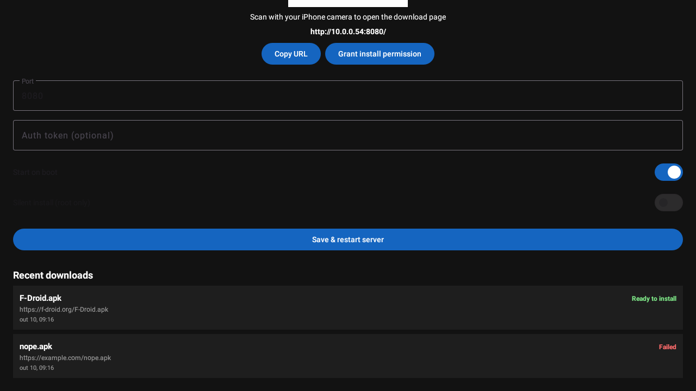

# APK Receiver

[](https://github.com/feliperezende/apk-receiver/actions/workflows/build.yml)
[](https://github.com/feliperezende/apk-receiver/releases/latest)

Send APK download URLs from your **iPhone** to an **Android TV box** over your local
network. The box app runs a tiny HTTP server, shows a QR code, downloads the APK with
Android's `DownloadManager`, and opens the package installer (or installs silently if
the box is rooted).

No Play Services required — works on plain AOSP boxes.

<p align="center">
  
</p>

## How it works

```
iPhone camera  ──scan QR──►  http://<box-ip>:8080/?token=...
        │
        └─ paste APK URL ──►  POST /fetch
                                   │
                                   ▼
                     DownloadManager  ──►  /sdcard/Download/<name>.apk
                                   │
                                   ▼
                   Installer dialog on the TV (or silent `pm install` if rooted)
```

## Features

- **QR code** on the TV — scan with the iPhone Camera and the web page opens instantly.
- **Web UI** to paste an APK URL, submit, and watch live progress + history.
- **DownloadManager** based download: handles redirects, large files, and backgrounding.
- **Install dialog** appears on the TV; **silent install** option for rooted boxes.
- **Recent downloads** list persisted and shown both in the app and on the web page.
- **Optional auth token** (embedded in the QR URL) to keep the endpoint private.
- **Auto-start on boot** and a foreground service so the box is always reachable.
- **iOS Shortcut** (optional) to push links straight from the Share Sheet.
- **CI/CD**: every merge to `main` builds and publishes a new versioned APK release.

## Quick start

### 1. Get the APK

Download the latest APK from the [Releases page](https://github.com/feliperezende/apk-receiver/releases/latest)
(`app-debug.apk`), or build it yourself (see [Building from source](#building-from-source)).

### 2. Install on the box

Enable **Developer options → ADB over network** on the TV box, then:

```bash
adb connect <box-ip>:5555
adb install -r app-debug.apk
```

You can also sideload it with any file-transfer app or a USB drive.

### 3. First run

1. Open **APK Receiver** on the TV.
2. Tap **Grant install permission** and enable *Allow from this source*.
   (On Android 7 and older this opens the global "Unknown sources" setting.)
3. The app shows a **QR code** — scan it with your iPhone Camera.

### 4. Send an APK

Safari opens the receiver page. Paste an APK URL and tap **Download & Install**.
The TV downloads the file and shows the installer dialog — confirm with the remote.

## Optional: iOS Shortcut

Add a **Send to TV** shortcut to the iOS Share Sheet so you can push any link to the box:

1. Shortcuts → new shortcut named `Send to TV`.
2. Add **Receive** *URLs* from **Share Sheet**.
3. Add **Get Contents of URL**:
   - URL: `http://<box-ip>:8080/fetch`
   - Method: `POST`
   - Headers: `X-Auth-Token` = your token (if set)
   - Request Body: `JSON`, field `url` = `Shortcut Input`
4. Enable *Show in Share Sheet* with types **URLs** and **Text**.

## App settings

| Setting | Description |
|---|---|
| **Port** | HTTP port (default `8080`) |
| **Auth token** | Optional shared secret; embedded in the QR URL |
| **Start on boot** | Relaunch the server after reboot |
| **Silent install** | Root only — runs `su -c "pm install -r"`, no dialog |

## HTTP API

```
GET  /                        web UI (index.html)
GET  /ping                    {"ok":true,...}
POST /fetch  {"url","name"?}  -> {"id","name","url"}
GET  /status?id=<id>          download status / progress
GET  /history                 recent downloads with status
```

- Auth: if a token is set, requests must include header `X-Auth-Token: <token>`,
  query `?token=<token>`, or JSON field `token`.
- Only `http` / `https` URLs are accepted.

## Building from source

**Requirements:** JDK 17, Android SDK (platform 34, build-tools 34.0.0).

### Android Studio

Open the project folder and run *Build → Build Bundle(s)/APK(s) → Build APK(s)*.

### Command line

```bash
./gradlew assembleDebug
# APK: app/build/outputs/apk/debug/app-debug.apk
```

Version overrides for CI:

```bash
./gradlew assembleDebug -PversionCode=42 -PversionName=1.0.42
```

If Gradle can't find the SDK, create `local.properties`:

```properties
sdk.dir=/path/to/Android/Sdk
```

## Releases & CI

`.github/workflows/build.yml` runs on every push to `main`:

1. Builds the debug APK with `versionCode = <run_number>` and `versionName = 1.0.<run_number>`.
2. Uploads it as a workflow artifact.
3. Publishes a GitHub Release tagged `v1.0.<run_number>` with `app-debug.apk` attached.

So every merge to `main` produces a new downloadable version.

## Project structure

```
app/src/main/java/com/felipe/apkreceiver/
├── HttpServerService.kt   Foreground service + NanoHTTPD server lifecycle
├── WebServer.kt           HTTP routes: web UI, /fetch, /status, /history
├── DownloadReceiver.kt    Fires on download completion
├── InstallHelper.kt       Installer intent (dialog) + rooted silent install
├── DownloadHistory.kt     Persisted, shared download history
├── MainActivity.kt        QR code + settings + recent downloads
├── QrGenerator.kt         ZXing QR bitmap
├── NetUtils.kt            LAN IP detection
├── Notifications.kt       Notification channel + helpers
├── Prefs.kt               Settings storage
└── BootReceiver.kt        Auto-start on boot
app/src/main/assets/index.html   Web UI
```

**Tech stack:** Kotlin, NanoHTTPD, ZXing, Android `DownloadManager`, `FileProvider`,
Material Components, View Binding.

## Troubleshooting

- **Server offline / QR opens nothing** — make sure the phone and box are on the same
  network and the IP in the app matches; reopen the app to refresh the QR.
- **"Could not enqueue download"** — the box needs storage access; grant the
  storage permission prompt (the app requests it on first launch).
- **No install dialog** — tap *Grant install permission*, and ensure the URL ends in `.apk`.
- **Boot autostart does nothing on Android 15+** — recent Android restricts starting
  data-sync foreground services from `BOOT_COMPLETED`; open the app once after boot or
  use a rooted boot script.
- **Token mismatch (401)** — re-scan the QR after changing the token.
